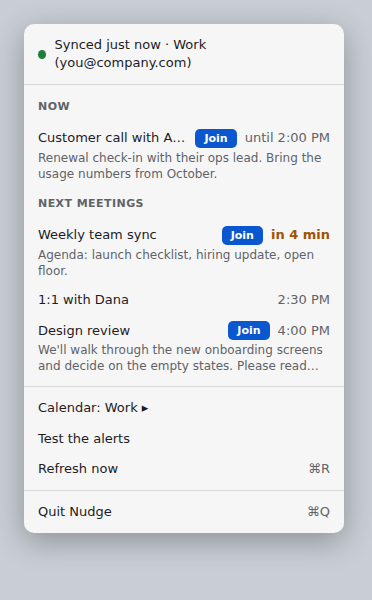
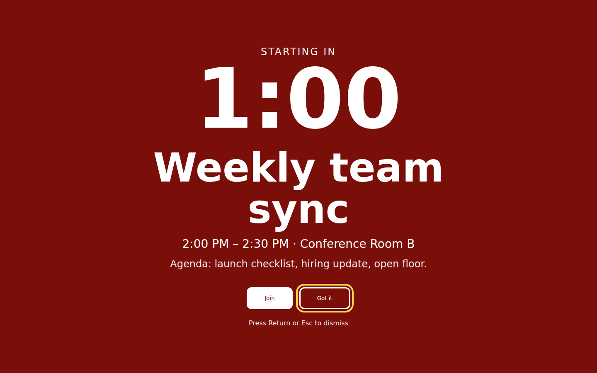
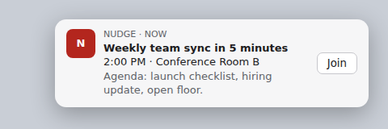

[](https://github.com/tabrez96/nudge/actions/workflows/test.yml)

<!-- about -->
# Nudge

**A Mac menu bar app that warns you before Google Calendar meetings**

## What it does

Nudge is a menu-bar-only macOS app (no Dock icon, no windows) that reads your Google calendar through macOS EventKit. The Google account is added in System Settings → Internet Accounts, so the app has no OAuth code or secrets. Every second the app checks the cached meetings: at T-5 min it plays a sound and posts a banner (S03); at T-1 min it covers every screen with a red countdown (S02). Every 60 s it re-reads the calendar; if that fails it keeps alerting from the last good data and shows the problem in the menu (S01) and a red icon. All timing, sync, status and display-text logic lives in a pure-Foundation library that builds and tests on Linux; the thin AppKit/EventKit shell compiles only on macOS and is verified by hand.

## Screens

### S01 · Menu bar menu

Check that Nudge is working, see what's next, and fix problems



### S02 · Full-screen warning

Make it impossible to miss that a meeting starts in one minute



### S03 · Five-minute banner

Early heads-up with sound, 5 minutes before a meeting



## Built with

- **Swift 5.9+, SwiftPM**: native macOS per the brief; SwiftPM builds on Linux so QA can run the core tests without Xcode.
- **AppKit (`NSStatusItem`, `NSMenu`, borderless `NSWindow`)**: menu-bar apps and full-screen overlays are simplest and most controllable in AppKit; SwiftUI adds nothing here.
- **EventKit**: reads the Google calendar macOS already syncs; no OAuth, no network code, no credentials.
- **UserNotifications + NSSound**: system banner for S03; sound plays via `NSSound` separately so it still sounds if banners are denied or muted (S03 spec).
- **Storage**: `UserDefaults` for the chosen calendar ID only. Last good meetings are kept in memory: alerts only fire while the app runs, so persisting them buys nothing for the MVP.
- **Hosting/distribution**: none. `scripts/make-app.sh` builds an ad-hoc-signed `build/Nudge.app` on your Mac.
- **Tests**: XCTest via `swift test` on Linux for `NudgeCore`.
<!-- /about -->

## Get the app

Download the latest `Nudge-<version>.dmg` from the [Releases page](https://github.com/tabrez96/nudge/releases)
(builds are published as pre-releases, so pick the newest one at the top), open it, and drag Nudge onto
Applications. Nudge needs macOS 13 or newer and a Google account added in System Settings → Internet
Accounts with Calendars turned on, and asks for notification access on first launch. To let Nudge read your calendar, choose **Allow calendar access…** from its menu.

Nudge isn't notarized, so macOS blocks the first launch: try to open it once, then go to System
Settings → Privacy & Security and click Open Anyway (on macOS 13 and 14 you can instead right-click
Nudge, choose Open, then Open again). To check the download, also grab `Nudge-<version>.dmg.sha256`
and run `shasum -a 256 -c Nudge-<version>.dmg.sha256` in the same folder.

## Development

Requires Swift 5.9 or newer. On macOS, install Xcode 15+ (or the command line tools). On Linux, install
Swift with [swiftly](https://www.swift.org/install/linux/); only the `NudgeCore` library and its tests
are meaningful there.

```sh
swift build        # build everything
swift test         # run the NudgeCore tests (works on Linux and macOS)
swift run Nudge    # macOS: starts the menu bar app; Linux: prints a "macOS only" message
```

The app icon is built from `Support/AppIcon/AppIcon-1024.png`, which `scripts/make-icon-master.sh` renders from
`design/brand/mark.svg` (needs `rsvg-convert`). Rerun it and commit the PNG when the mark changes;
`scripts/make-app.sh` turns it into `AppIcon.icns`.

Layout:
- `Sources/NudgeCore` — pure-Foundation logic (timing, sync, display text), tested on Linux.
- `Sources/Nudge` — the macOS app shell (AppKit/EventKit), compiled only on macOS.
- `Tests/NudgeCoreTests` — XCTest tests for `NudgeCore`.

---

<sub>Created with ❤️ by Dunder Mifflin agents</sub>
