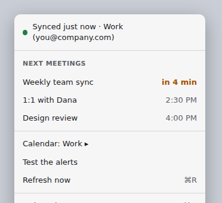
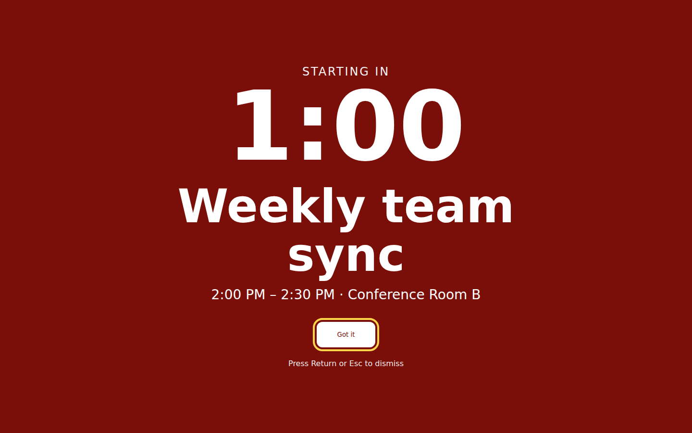
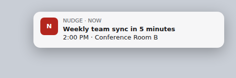

<!-- about -->
# Nudge

**A Mac menu bar app that warns you before Google Calendar meetings**

Status: Released

## What it does

Nudge is a menu-bar-only macOS app (no Dock icon, no windows) that reads your Google calendar through macOS EventKit. The Google account is added in System Settings → Internet Accounts, so the app has no OAuth code or secrets. Every second the app checks the cached meetings: at T-5 min it plays a sound and posts a banner (S03); at T-1 min it covers every screen with a red countdown (S02). Every 60 s it re-reads the calendar; if that fails it keeps alerting from the last good data and shows the problem in the menu (S01) and a red icon. All timing, sync, status and display-text logic lives in a pure-Foundation library that builds and tests on Linux; the thin AppKit/EventKit shell compiles only on macOS and is verified by hand.

## Screens

### S01 · Menu bar menu

Check that Nudge is working, see what's next, and fix problems



### S02 · Full-screen warning

Make it impossible to miss that a meeting starts in one minute



### S03 · Five-minute banner

Early heads-up with sound, 5 minutes before a meeting



## Built with

- **Swift 5.9+, SwiftPM**: native macOS per the brief; SwiftPM builds on Linux so QA can run the core tests without Xcode.
- **AppKit (`NSStatusItem`, `NSMenu`, borderless `NSWindow`)**: menu-bar apps and full-screen overlays are simplest and most controllable in AppKit; SwiftUI adds nothing here.
- **EventKit**: reads the Google calendar macOS already syncs; no OAuth, no network code, no credentials.
- **UserNotifications + NSSound**: system banner for S03; sound plays via `NSSound` separately so it still sounds if banners are denied or muted (S03 spec).
- **Storage**: `UserDefaults` for the chosen calendar ID only. Last good meetings are kept in memory: alerts only fire while the app runs, so persisting them buys nothing for the MVP.
- **Hosting/distribution**: none. `scripts/make-app.sh` builds an ad-hoc-signed `build/Nudge.app` on your Mac.
- **Tests**: XCTest via `swift test` on Linux for `NudgeCore`.
<!-- /about -->

## Development

Requires Swift 5.9 or newer. On macOS, install Xcode 15+ (or the command line tools). On Linux, install
Swift with [swiftly](https://www.swift.org/install/linux/); only the `NudgeCore` library and its tests
are meaningful there.

```sh
swift build        # build everything
swift test         # run the NudgeCore tests (works on Linux and macOS)
swift run Nudge    # macOS: starts the menu bar app; Linux: prints a "macOS only" message
```

Layout:
- `Sources/NudgeCore` — pure-Foundation logic (timing, sync, display text), tested on Linux.
- `Sources/Nudge` — the macOS app shell (AppKit/EventKit), compiled only on macOS.
- `Tests/NudgeCoreTests` — XCTest tests for `NudgeCore`.

### Mac setup

1. Add your Google account in System Settings → Internet Accounts and turn on Calendars. Wait for its calendars to show up in the Calendar app. Nudge reads them through macOS and never asks for a Google password.
2. On first launch, macOS asks for calendar access. If you said no, turn it on in System Settings → Privacy & Security → Calendars.
3. On first launch, macOS also asks to allow notifications. If you said no, Nudge still plays its sound and the menu says notifications are off; turn them on in System Settings → Notifications → Nudge (alert style Banners or Alerts).

### Build the app

```sh
scripts/make-app.sh
open build/Nudge.app
```

The script builds in release mode, copies the binary and `Support/Info.plist` into `build/Nudge.app`, and ad-hoc signs the bundle (`codesign --sign -`), so it only runs on the Mac that built it. The app has no Dock icon and lives in the menu bar. Click the bell in the menu bar to see sync status and your next meetings. Five minutes before a meeting Nudge plays the Glass sound and posts a banner. One minute before, a red full-screen warning with a countdown covers every screen, including full-screen apps and other Spaces; Got it, Return or Esc closes it everywhere. To try both without waiting for a meeting, choose Test the alerts in the menu: the banner and sound come right away, and the full-screen warning for a fake meeting follows about 5 seconds later. Test alerts don't affect real meetings. Alerts are also logged to Console.app (search for "Nudge alert"). Run the bundled app for banners: `swift run Nudge` has no app bundle, so it plays the sound only.

### Manual checklist

Run this on your Mac after `scripts/make-app.sh` whenever the app shell changes. It covers every flow in
`design/ux.md` (Key flows). Use a Google account with a calendar you can add test events to.

**1. First run (no access → normal)**
1. Quit Nudge. Run `tccutil reset Calendar app.nudge.Nudge` and `tccutil reset Notifications app.nudge.Nudge` (the second may print an error on some macOS versions; ignore it).
2. `open build/Nudge.app`. macOS asks to allow notifications: click Allow.
3. The bell is red. The menu says "Nudge can't see your calendar yet." with "Allow calendar access…" and "Add Google account in Internet Accounts…".
4. Click "Add Google account in Internet Accounts…": System Settings opens on Internet Accounts. Close it.
5. Click "Allow calendar access…" and allow full access. Within a few seconds the bell turns normal and the menu shows a green dot and "Synced just now · <your calendar>".

**2. Calendar picker**
1. Create a meeting later today on your Google calendar and another on a second calendar, so the full menu shows on both (with no more meetings today the menu shows only "No more meetings today. Enjoy the quiet." and Quit, with no picker to switch back).
2. Open Calendar: the submenu lists every calendar, with a checkmark on the current one. Pick another one: the status line and meeting list switch to it.
3. Quit and reopen Nudge: the pick is kept. Switch back to your Google calendar.

**3. Test the alerts**
1. Choose Test the alerts. The Glass sound plays and a banner reads "Test meeting in 5 minutes" with the time 5 minutes from now.
2. About 5 seconds later every screen turns red: "STARTING IN", 1:00 counting down, "Test meeting", and its time range. Got it has a yellow focus ring.
3. Press Esc: every screen closes. Repeat with Return, then with clicking Got it.

**4. A real meeting (T-5 banner, T-1 full screen)**
1. Create a meeting starting 6 minutes from now, with a location. Within a minute it appears in the menu. Before its T-5 alert, choose Test the alerts: the Next meetings list is unchanged, and this meeting still alerts at T-5 and T-1 below.
2. At 5 minutes before: the sound plays and the banner reads "<title> in 5 minutes" with "<time> · <location>". The menu shows "in 5 min" in bold amber.
3. At 1 minute before: every screen turns red with the countdown. It runs down to "Starting now" and stays until Got it, Return or Esc.
4. Each alert fires once: reopening the menu or clicking Refresh now does not fire them again.

**5. Sync failure (error state)**
1. Create a meeting about 8 minutes out on your Google calendar and wait until the menu shows it.
2. In System Settings → Internet Accounts, open your Google account and turn Calendars off.
3. Within a minute the bell turns red. The menu shows "Can't reach your calendar. Alerting from data saved at <time>.", the "Next meetings (last saved)" list and "Retry now ⌘R". No popup appears.
4. Leave Calendars off: the banner at T-5 and the full-screen warning at T-1 still fire for that meeting.

**6. Recovery**
1. Turn Calendars back on for the Google account and wait for it to show up in the Calendar app.
2. Click Retry now (or wait up to a minute). The bell turns normal and the menu shows a green dot and "Synced just now · <your calendar>".
3. Turn notifications off in System Settings → Notifications → Nudge, then open the menu: it says "Notifications are off for Nudge. Sound still plays." Test the alerts plays the sound with no banner. Turn notifications back on.

### Check the full-screen warning by hand

1. With two displays connected and an app in full screen on one of them, create a meeting starting in 3 minutes with a location, and another 3 minutes later with no location.
2. At one minute before the first: every screen turns red, "Got it" has a yellow ring, the countdown runs 1:00 → 0:01, then shows "Starting now" (the "STARTING IN" line disappears) and stays.
3. Press Esc: all screens close. Repeat with Return and with clicking Got it on the second display.
4. Leave the first warning open: when the second fires it replaces it and shows only the time range.
5. With VoiceOver on (⌘F5), the warning is read once when it opens, not every second.

---

<sub>Created with ❤️ by Dunder Mifflin agents</sub>
